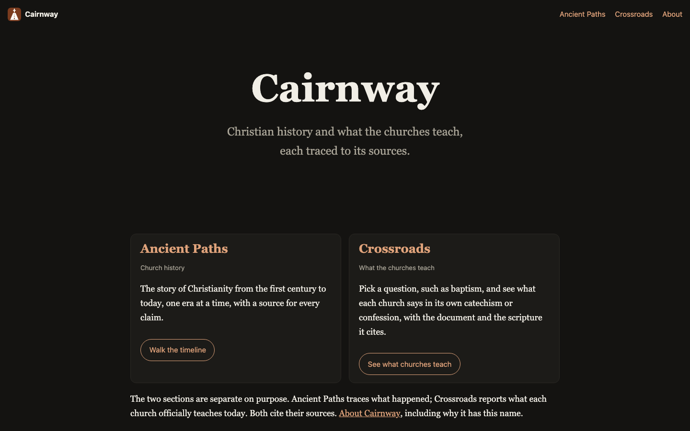
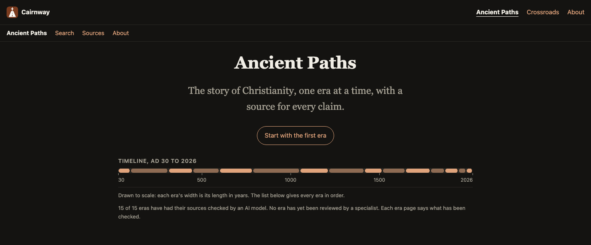
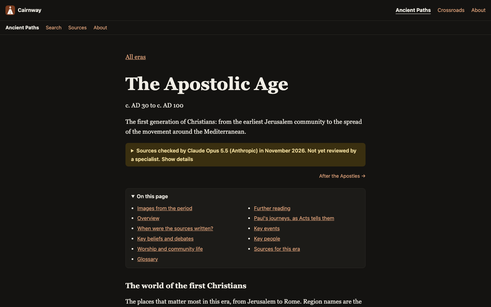
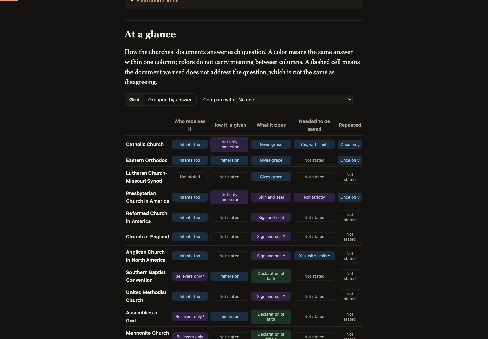
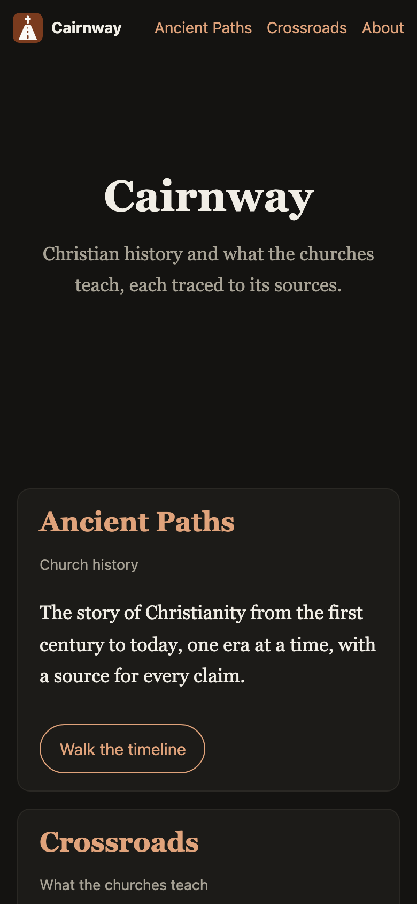
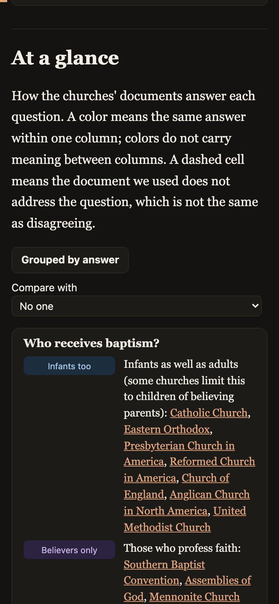

<p align="center">
  
</p>

# Cairnway

[](https://github.com/githubacct54385/Cairnway/actions/workflows/ci.yml)
[](LICENSE)
[](CONTENT-LICENSE.md)

**Live site: <https://cairnway.org/>**

**Cairnway is a website for learning Christian history and what the churches teach, with every claim traced to a
source.** It is for anyone who wants to understand where the faith came from, whatever they believe, and to check the
evidence for themselves.

The site has two sections:

- **Ancient Paths (`/history`)**: a scrolling timeline of Christian history, one era at a time, starting with the first
  century (the Apostolic Age). Each era lists its people, events and sources, and each claim has a citation. Where
  historians disagree, the page names the views and who holds them.
- **Crossroads (`/crossroads`)**: it answers questions such as baptism by showing what each church
  says in its own catechism or confession, with the document and the scripture it cites. Crossroads reports what
  churches officially teach today; the history section traces what happened.

The site also has a search page, a page listing every source and its license, and a form for reporting corrections.

## Screenshots

<p align="center">
  
</p>

**Ancient Paths** is a scrolling timeline. Each of the 15 eras has its own page with people, events, maps and a citation for every claim.

<p align="center">
  
</p>
<p align="center">
  
</p>

**Crossroads** compares what churches officially teach, in the words of their own catechisms and confessions. It is a grid on larger screens and a grouped list on phones.

<p align="center">
  
</p>

<table align="center">
  <tr>
    <td></td>
    <td></td>
  </tr>
</table>

> **Status:** early work in progress (`prelaunch: false` in `src/config.ts`, so search engines may index it). Pages marked
> "Draft" have not yet been reviewed against their sources. Pages are first drafted with the help of an AI and then
> checked against their sources; each era's banner says what has been checked so far.

## Who it is for

- Readers who want a clear, sourced overview of Christian history and doctrine.
- Students and teachers who need the primary sources and their licenses in one place.
- Anyone who spots an error or a missing source and wants to suggest a correction. See [CONTRIBUTING.md](CONTRIBUTING.md).

## What it is not

- It is not a scholarly authority. It summarizes published sources and points to them.
- It does not present one church's teaching as the whole story. Each section attributes views to the people or traditions
  that hold them.

## How it is built

- [Astro](https://astro.build) with TypeScript, producing a fully static site
- [GSAP](https://gsap.com) with ScrollTrigger for the scroll animation (it respects reduced-motion settings)
- [Pagefind](https://pagefind.app) for search, built from the generated pages
- Content as Markdown files in `src/content/eras/`, validated by a schema in `src/content.config.ts`
- A [Cloudflare Worker](https://developers.cloudflare.com/workers/) in `worker/` for the report form,
  protected by Cloudflare Turnstile

## Engineering highlights

A static site is the simple part. These are the pieces behind it that I'd point to.

**Architecture**

- **Static first, one small server.** Pages are built ahead of time with Astro and TypeScript. The only dynamic feature, the
  report form, is a single Cloudflare Worker that handles `/api/*`; everything else is served as static files.
- **Content as typed data.** Eras, topics, churches and teachings are Markdown and JSON files checked against Zod schemas.
  Cross-references are validated at build time, so an unknown church, topic, era or answer, or a missing passage pointer,
  fails the build with a message that names the entry.
- **A comparison engine.** Crossroads shows how twelve churches answer the same questions, as a grid or grouped by answer,
  with a "compare with" mode. A pairwise agreement score skips "not stated" instead of counting it as disagreement, and an
  average-linkage clustering turns the scores into a tree of which churches agree most.
- **Search without a server.** [Pagefind](https://pagefind.app) builds the index at build time, with a filter to search
  one section or both.

**Security**

- **Content Security Policy built from the output.** `scripts/write-headers.mjs` hashes every inline script after the build and
  writes the CSP from those hashes, so only shipped scripts can run. It fails the build on inline event handlers. The site also
  sends `X-Frame-Options: DENY`, `nosniff`, a strict referrer policy and a locked-down permissions policy.
- **A hardened form endpoint.** The Worker requires a same-origin request, validates input, uses a honeypot, verifies
  Cloudflare Turnstile server-side, and applies a per-IP rate limit plus a daily cap stored in KV. User text is escaped
  before it becomes a public GitHub issue, and the reporter's contact goes to an email and is never stored or published.
- **Isolated staging.** Staging is a separate Worker with no secrets, behind Cloudflare Access.
- **Supply chain.** GitHub Actions are pinned to commit SHAs, Wrangler runs from the lockfile, Dependabot is on, and there is
  a [security policy](SECURITY.md).

**Delivery**

- **Pipeline with a human gate.** Every pull request is built and checked. Green PRs squash-merge automatically and deploy to
  staging. Production waits for approval and deploys the exact files that were tested on staging, with no rebuild. A run that is
  no longer the newest commit is skipped, so an older build can never replace a newer one.
- **Quality gates in CI.** `npm run check` scans the built site and fails on broken internal links or `#fragments`, pages
  without exactly one `h1`, skipped heading levels, and missing or duplicate titles and meta descriptions. I tested it by
  planting each kind of defect and confirming it fails.

**User experience**

- **Responsive by design, not by accident.** The six-column comparison grid cannot fit on a phone, so phones get a grouped view
  with labels instead. I tested every page at phone, tablet and desktop widths and fixed what I found.
- **Gentle on readers.** The scroll animation respects reduced-motion settings, and the content is plain HTML that reads without
  JavaScript.
- **Honest about its limits.** Every era says what was checked and by whom (an AI model, not yet a specialist). Every source
  is logged in [SOURCES.md](SOURCES.md) with its license, and written content is CC BY 4.0.

## Run it locally

You need Node.js 22 or newer.

```sh
npm install
npm run dev        # development server (search is not available here)
npm run build      # production build plus the search index, in ./dist
npm run preview    # serve the production build locally
npm run check      # after a build: broken links, heading levels, titles and meta descriptions
```

## Project layout

```
src/content/eras/   one Markdown file per era (frontmatter holds people, events and sources)
src/pages/          home, history and crossroads pages, search, sources and permissions
src/layouts/        shared page layout
src/scripts/        scroll animation
src/config.ts       site names, descriptions and the prelaunch flag
worker/             Cloudflare Worker: report form
scripts/cite.py     prints a cited passage from downloaded source texts, for checking citations
SOURCES.md          log of every source and its license
docs/               deployment, launch and review notes
```

## Contributing

Suggestions and corrections are welcome. See [CONTRIBUTING.md](CONTRIBUTING.md). Reviews happen as time permits.

## Licenses

- Code: [MIT](LICENSE)
- Original text: [CC BY 4.0](CONTENT-LICENSE.md)
- Third-party material keeps its own license, listed in [SOURCES.md](SOURCES.md)

This site summarizes published sources and is not itself a scholarly authority. It is made by a Christian, with the aim of
presenting the evidence fairly; see the About page (`src/pages/about.astro`).
